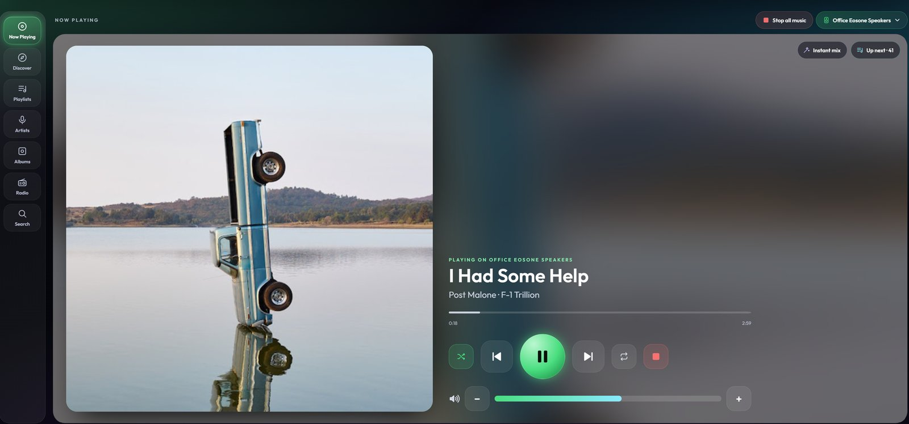
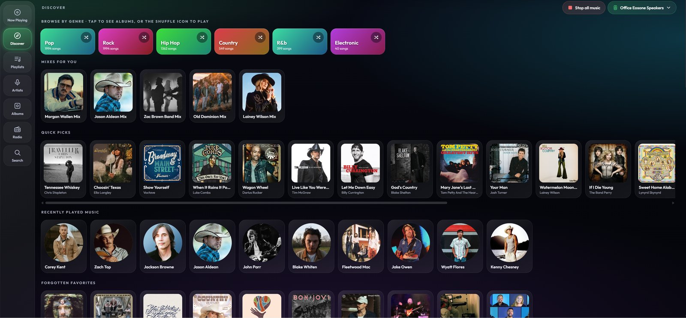
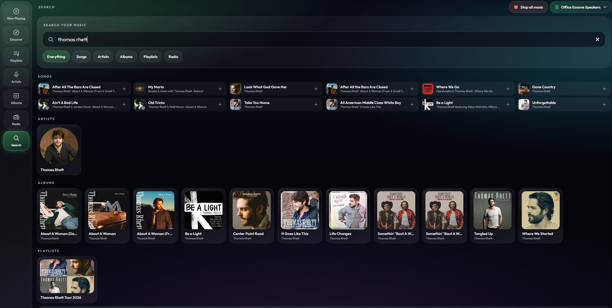
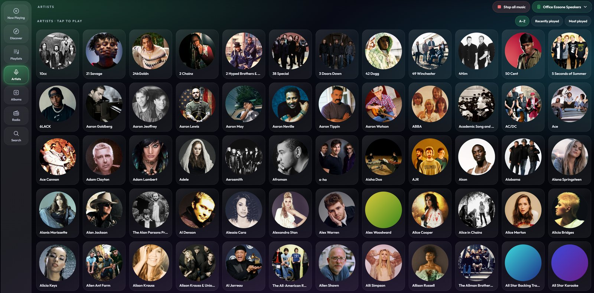
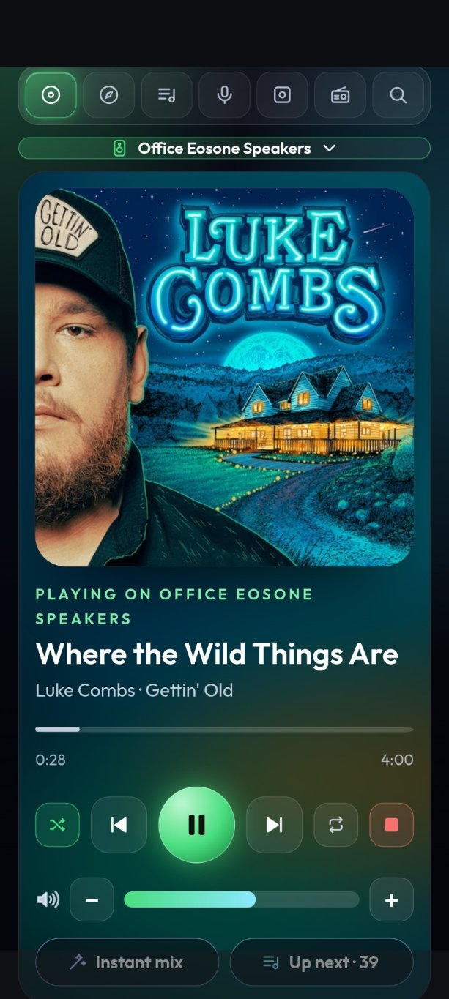

# MA Easy Player

A simple, touch-friendly [Music Assistant](https://www.music-assistant.io/) player card for Home Assistant dashboards. It's built for wall tablets, desktop and mobile dashboards: big album art, large buttons, and navigation that doesn't make you dig.



| Discover | Search | Artists |
|---|---|---|
|  |  |  |

**On a phone:**



---

## ⚠️ Please read first: I'm not a developer

I'm a Home Assistant hobbyist, not a programmer. I built this card with a lot of help from Claude (Anthropic's AI assistant) because I couldn't find a music card that was truly easy to use, especially for stopping music, clearing the queue and grouping speakers.

What that means for you:

- **Provided as-is.** It works well in my house, but I can't promise it will work in yours.
- **Support is limited.** I'll read issues when I can, but I can't fix every bug or build every feature request myself.
- **Enhancements are welcome from the community.** If you can code and want to improve it, please open a pull request, or fork it and make it your own. That's the best way this card will get better.

---

## What's new in 2.1.2

- **Sync groups follow changes you make in Music Assistant.** If you swap or add a speaker in a Music Assistant sync group, the card picks it up right away. Before, the card remembered a group's speakers the first time it saw the group, so after a swap it could show the group as "+1" or "2 speakers" and treat the group's own speaker as an extra one you had added.
- The card now reads each group's speakers from the group's settings in Music Assistant, because newer Music Assistant versions can report that list as empty elsewhere. The speakers it hides because they belong to a sync group follow the same list.

## What's new in 2.1.1

- **No more duplicate speakers:** newer Music Assistant versions add a second "dashboard" copy of some players (for example two "Family Room TV" entries, one marked "Can't group"). The card now hides those copies. You can still show one by listing it under `include`.

## What's new in 2.1

- **Discover page:** browse your library by genre (tap a genre for its albums, or its shuffle icon to play a random mix of that genre), plus Music Assistant's own suggestion rows such as recently added and favorites.
- **Mute button:** tap the speaker icon beside the volume slider to mute or unmute. It shows a speaker with a line through it while muted, and works even with speakers that don't report their mute state.
- **Volume through another device:** send a speaker's volume to a receiver when the streamer's own volume is fixed (`volume_entities`).
- **Keep a speaker out of groups** (`no_group`), and the grey "Can't group" label is hidden for those speakers.
- **Hide Stop all music** on a dashboard (`show_stop_all: false`), handy for a simple dashboard for a family member.
- **Small-tablet options:** `compact` (smaller buttons on one row) and `min_height`.
- **Smarter speaker memory:** each dashboard only reuses the last speaker you picked if that dashboard offers it.
- **Fixes:** the Search filter buttons and the one-tap group buttons no longer float in a tall empty box; ignores a speaker that wrongly says it's still playing after a group breaks up; an empty queue no longer causes an error; sync group members are only hidden when the dashboard actually shows that group.

---

## Features

**Now Playing**

- Large album art with a blurred-art colour background that changes with every song
- Big play/pause, previous/next, shuffle, repeat and a dedicated **stop** button
- Tap the progress bar to jump within a song; tap or use − / + to set volume
- Tap the speaker icon beside the volume slider to **mute / unmute**
- **Up next** slide-out tray: tap a song to jump to it, ✕ to remove it, **Clear** to empty the rest of the queue
- **Instant mix:** one tap replaces everything after the current song with up to 50 sonically similar songs **from your own library** (see [Instant mix](#instant-mix))
- **Follows the music:** when a speaker starts playing music from Music Assistant, the card switches to it automatically (unless you picked a speaker yourself in the last 2 minutes)

**Browse and play** (one tap plays on the current speaker)

- **Discover:** genre tiles (tap for albums, or the shuffle icon to play the genre) and Music Assistant's suggestion rows, scrolling sideways
- Playlists, Artists, Albums and Radio from your Music Assistant library
- Sort A–Z, Recently played or Most played
- Search across your library and providers, with filters; songs have **+** to add to the queue

**Speakers and grouping**

- Tap the speaker name at the top to open the Speakers screen, then **Select** a speaker to control it
- **Add / Remove** speakers to build a group; only speakers Music Assistant says can group together are offered, the rest show "Can't group"
- **Move music here** transfers the queue to another speaker
- **Ungroup all** in one tap
- **One-tap groups:** group some speakers, tap "Save as one-tap group", and it becomes a button (long-press to delete). You can also define groups in the card config.
- **Stop all music** button on every screen (can be hidden)
- Optional **toggle buttons** next to Stop all music, for things like turning on an amplifier. They can be set to show only when a particular speaker is selected.
- Speakers you mark with `no_group` can still be selected or receive music, but are never offered for grouping

**Layout**

- Left navigation rail with big buttons; a mini player shows on every other screen
- Automatically compacts at tablet width; `compact` and `min_height` options for small tablets
- **Phone layout:** a slim row of icon-only section buttons, the player first, and Stop all music and your toggle buttons below the player
- Optional **Home** button at the top of the rail for wall tablets that hide the sidebar

---

## Requirements

| Requirement | Needed for |
|---|---|
| Home Assistant with the **Music Assistant** integration | Everything (required) |
| **Music Assistant Queue Actions** (`mass_queue`) custom integration | The Up next tray, Instant mix, the Discover page, and accurate "can this speaker group?" checks. Optional: the rest of the card works without it. |
| A music provider in Music Assistant that offers **similar tracks** (Plex by default) | Instant mix only |

---

## Installation

### Through HACS / Marketplace (recommended)

1. Open **HACS** (on Home Assistant 2026.11+: **Settings → Marketplace**).
2. Add this repository as a custom repository, category **Dashboard / Lovelace**:
   `https://github.com/deejay4959/ma-easy-player-card`
3. Install **MA Easy Player**, then refresh your browser.

### Manual

1. Download `ma-easy-player-card.js` and copy it to `/config/www/`.
2. Go to **Settings → Dashboards → Resources** and add `/local/ma-easy-player-card.js?v=2.1.2` as a **JavaScript module**.
3. Refresh your browser (Ctrl+Shift+R).

---

## Configuration

Minimal:

```yaml
type: custom:ma-easy-player-card
entity: media_player.living_room
```

Full example:

```yaml
type: custom:ma-easy-player-card
entity: media_player.living_room          # speaker selected the first time the card loads
stop_all_script: script.stop_all_music    # optional; without it, "Stop all music" stops every playing speaker
volume_step: 5                            # % per − / + press
pinned:                                   # shown first on the Speakers screen
  - media_player.living_room
  - media_player.kitchen
presets:                                  # one-tap groups
  - name: Downstairs
    leader: media_player.living_room
    members:
      - media_player.kitchen
      - media_player.dining_room
exclude:                                  # hide these from the Speakers screen
  - media_player.some_tv
chips:                                    # optional toggle buttons beside "Stop all music"
  - name: Patio amp
    icon: mdi:speaker-wireless
    entity: switch.patio_amp              # on/off state shown on the button; tapped = toggled
    show_for:                             # optional: only show when one of these speakers is selected
      - media_player.living_room
volume_entities:                          # this speaker's volume slider controls the receiver instead
  media_player.living_room_tv: media_player.receiver
no_group:                                 # can be selected / moved to, never grouped
  - media_player.flaky_speaker
home_path: /my-tablet/home                # optional Home button at the top of the rail
```

| Option | Type | Default | Description |
|---|---|---|---|
| `entity` | string | first Music Assistant player | Speaker to control on first load. After that, each browser remembers the last speaker you picked, as long as this dashboard offers that speaker. |
| `stop_all_script` | string | none | Script to run for **Stop all music**. |
| `show_stop_all` | boolean | `true` | Set to `false` to hide the **Stop all music** button. |
| `volume_step` | number | `5` | Volume change per − / + press. |
| `pinned` | list | `[]` | Speakers listed first on the Speakers screen. |
| `presets` | list | `[]` | One-tap groups (`name`, `leader`, `members`). |
| `exclude` | list | `[]` | Speakers hidden from the Speakers screen. |
| `include` | list | none | If set, **only** these speakers appear on the Speakers screen. |
| `volume_entities` | map | none | Send a speaker's main volume slider to a different device, e.g. `media_player.living_room_tv: media_player.receiver` when the TV streamer's own volume is fixed and the receiver does the volume. |
| `mute_scripts` | map | none | Tapping the speaker icon next to the volume slider mutes/unmutes the speaker (or its `volume_entities` device). To do more, map a speaker to a script, e.g. one that mutes a receiver and another speaker together. |
| `no_group` | list | `[]` | Speakers that can be selected or receive music with **Move music here**, but are never offered for grouping (handy for a speaker that drops out of groups). |
| `chips` | list | `[]` | Toggle buttons beside Stop all music. Each has `name`, `icon`, `entity` (whose state lights the button), and optionally `script` (run instead of toggling `entity`), `active_states` (states that count as on, default `[on]`), `show_for` (speakers that must be selected for the button to appear), and `volume_entity` / `volume_label` (adds a second volume slider while the button is on). |
| `home_path` | string | none | Adds a Home button that goes to this dashboard path. |
| `follow_playing` | boolean | `true` | Switch automatically to the speaker that starts playing. |
| `instant_mix` | boolean | `true` | Set to `false` to hide the Instant mix button. |
| `mix_provider` | string | `plex` | Music Assistant provider whose "similar tracks" feature builds the mix. |
| `mix_size` | number | `50` | Maximum number of songs in an instant mix. |
| `genre_min_tracks` | number | `15` | Discover: genres with fewer songs than this are hidden. |
| `genre_limit` | number | `24` | Discover: most genre tiles to show (biggest first). |
| `genre_shuffle_size` | number | `100` | Discover: songs queued when you shuffle a genre. |
| `discover_rows` | number | `12` | Discover: most Music Assistant suggestion rows to show. |
| `discover_exclude` | list | `[]` | Discover: suggestion rows to hide, by name or id. |
| `ma_url` | string | this host, port 8095 | Discover: address of your Music Assistant server, used for artwork. |
| `compact` | boolean | `false` | Smaller buttons on one row, for small tablets. |
| `min_height` | number | `640` | Minimum card height in pixels; lower it for small screens. |
| `config_entry_id` | string | auto-detected | Only needed if you run more than one Music Assistant instance. |

**Tip:** the card is designed to fill a large area. It works best in a **panel** view or a large grid area on a wall-tablet dashboard.

---

## Instant mix

Instant mix asks Music Assistant for songs that are sonically similar to the one playing, using a provider's **similar tracks** feature, and keeps only songs that are in **your own library** (no surprise streaming tracks). It then replaces everything after the current song with that mix.

- It needs `mass_queue` installed.
- By default it uses **Plex** (Plex's sonic analysis gives great results). If your library is on another provider that supports similar tracks, set `mix_provider` to that provider's name. I've only tested Plex.
- If the playing song isn't in that provider's library, the card tells you instead of guessing.

---

## Known limitations

- **Library, search and Discover artwork over HTTPS.** Artwork comes straight from your Music Assistant server (usually `http://…:8095`, or whatever you set in `ma_url`). If you open your dashboard over HTTPS (for example through Nabu Casa), the browser may block those images and you'll see coloured tiles instead. Now Playing artwork always works because it goes through Home Assistant.
- **Mute on speakers that don't report it:** some players (for example Music Assistant sync groups) never tell Home Assistant whether they're muted. The card remembers what it set, but each screen remembers separately, so a speaker muted from one screen won't show as muted on another.
- **One-tap groups saved from the card live in that browser only.** Put groups you want everywhere in `presets`.
- **Sync groups:** speakers that belong to a Music Assistant sync group are hidden individually and shown as the group. The card reads a group's speakers through Music Assistant Queue Actions (`mass_queue`). Without it, the card remembers a group's speakers in each browser, so after you change a group's speakers in Music Assistant, close and reopen the app (or clear that site's data) if the group shows an extra speaker.
- Grouping only works between speakers Music Assistant itself can sync.

---

## Contributing

Pull requests are very welcome, and so are forks. Please keep the spirit of the card: **simple, big, obvious controls.** If you open an issue, include your Home Assistant and Music Assistant versions, and any errors from your browser console.

## Credits

- Built by a Home Assistant hobbyist with help from Claude (Anthropic)
- Inspired by the Music Assistant community's "Custom Lovelace UI" discussion (#2601) and other community player cards
- Uses the Music Assistant integration and the Music Assistant Queue Actions (`mass_queue`) integration

## License

MIT, see [LICENSE](LICENSE).
